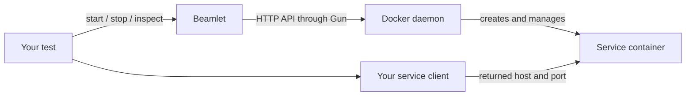
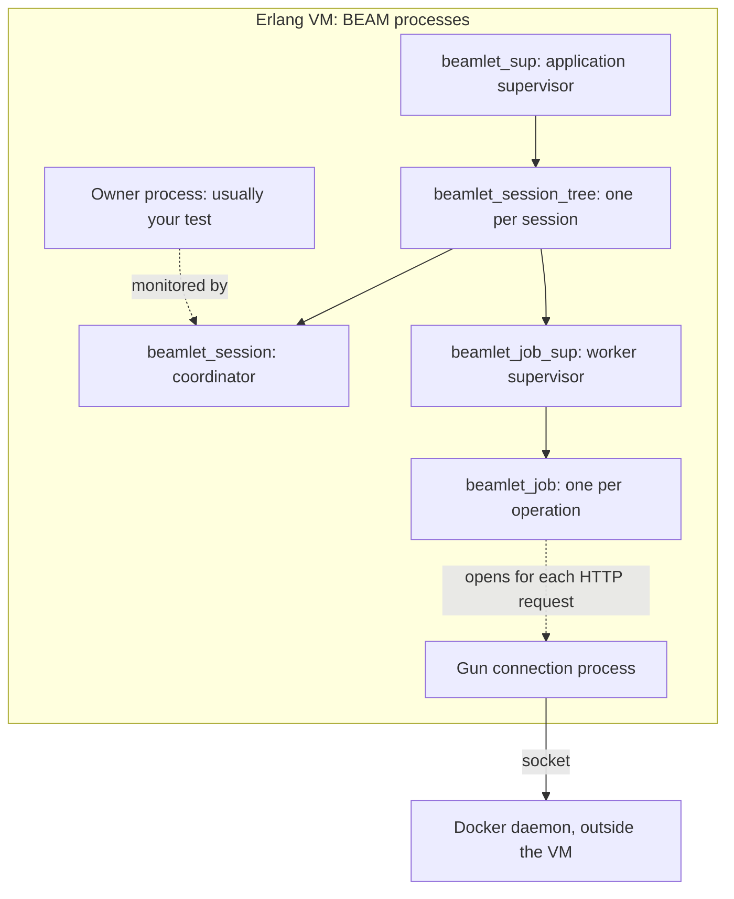
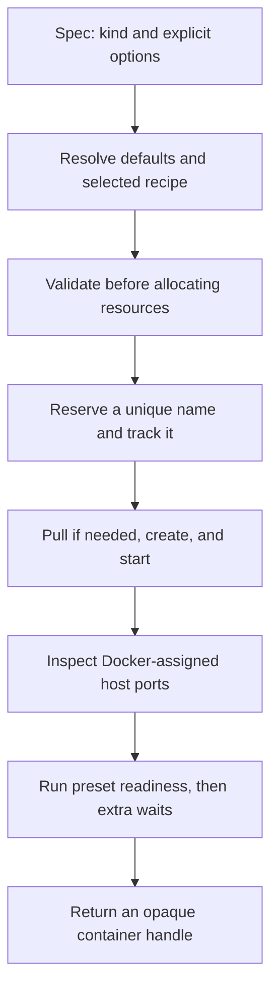
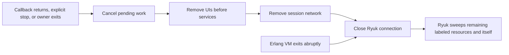

# How Beamlet works

Beamlet starts disposable Docker services for your tests, waits until they are
usable, and removes them afterward. A **session** keeps track of everything one
test or development stack owns.

```erlang
ok = beamlet:with_session(#{}, fun(Session) ->
    {ok, Redis} = beamlet:start_container(Session, beamlet_redis:new()),
    #{host := Host, port := Port} = beamlet_redis:client_config(Redis),
    %% Connect your Redis client here and run the test.
    io:format("Redis: ~s:~B~n", [Host, Port]),
    ok
end).
```

Client operations belong inside the callback: returning from it triggers cleanup.

## 1. Two paths: managing containers and using them



Beamlet sends Docker requests directly over a Unix socket or HTTP/TCP connection.
Your database, Kafka, or S3 client connects directly to the service. Docker assigns
the host port; use `beamlet:endpoint/2` or the preset's connection accessor to
retrieve it. Published ports, including Ryuk's, bind to loopback by default.
Remote access requires an explicit session `bind_ip`; the client `host` option
does not change the binding.

## 2. Inside the BEAM: processes, state, and messages

The **BEAM** is the Erlang virtual machine. Each Erlang process has a PID, a
mailbox, and its own heap and stack. Scheduler threads share execution time among
runnable processes, allowing work on multiple CPU cores. A process waiting for a
message lets other processes run. See OTP's [process guide](https://www.erlang.org/doc/system/ref_man_processes.html)
and [runtime scheduling reference](https://www.erlang.org/doc/apps/erts/erl_cmd.html).

A **module** contains code; a **process** executes it. Calling
`beamlet_runtime:start(...)` runs functions inside a worker process. It creates
no extra runtime process of its own. Redis and the other Docker services run
outside the Erlang VM.

### Which processes exist, and why?



Solid tree edges represent supervision links; dotted edges show other
relationships. Gun's connection process is opened and monitored by the worker,
separately from Beamlet's supervision tree.

| Process | What it does | Why it exists |
| --- | --- | --- |
| `beamlet_sup` | Starts a session subtree on demand. | Gives sessions an application-owned lifetime. |
| `beamlet_session_tree` | Groups the session and its worker supervisor. | When the session ends, the subtree shuts down too. |
| `beamlet_session` | A `gen_server` holding resource names, jobs, dependencies, and connection settings. | Gives each session one place to make lifecycle decisions. |
| `beamlet_job_sup` | Starts and stops temporary workers. | Lets the session cancel work without doing the I/O itself. |
| `beamlet_job` | Runs one bootstrap, startup, query, removal, or cleanup operation. | Slow Docker requests leave the coordinator free to handle other messages. |
| Gun connection process | Handles one HTTP connection and sends response messages to the worker. | Keeps socket handling separate from operation logic. |

`beamlet`, `beamlet_config`, preset modules, `beamlet_runtime`, `beamlet_docker`,
`beamlet_wait`, and `beamlet_deadline` provide functions. They do not each create
a long-lived process. Once a container is ready, its startup worker is gone; the
session keeps tracking the Docker container. The session stores state in an
immutable map passed between callbacks; workers report results by message rather than editing that map.

### How one request moves through them

```mermaid
sequenceDiagram
    participant C as Calling process
    participant S as Session gen_server
    participant J as Job supervisor
    participant W as Temporary worker
    participant G as Gun process
    C->>S: gen_server:call with start request
    S->>S: Resolve config and reserve resource name
    S->>J: supervisor:start_child
    J->>W: proc_lib:start_link
    W-->>J: init_ack: worker has started
    J-->>S: Worker PID
    Note over C,S: Caller waits; session returns noreply and handles other messages
    W->>G: Open connection and send Docker request
    G-->>W: HTTP response messages
    Note over W,G: Repeat for startup and readiness; close each HTTP connection
    W-->>S: {job_done, WorkerPid, Result}
    S->>S: Remove job tracking and update resource state
    S-->>C: gen_server:reply with result
    Note over W: Worker exits after reporting its result
```

A [`gen_server`](https://www.erlang.org/doc/apps/stdlib/gen_server.html) handles
one callback at a time. Returning `{noreply, State}` lets its message loop continue
while the caller waits. This is how independent starts can overlap without two
workers changing session state at once.

The worker uses [`proc_lib`](https://www.erlang.org/doc/apps/stdlib/proc_lib.html)
for OTP-compatible startup. It acknowledges **before** doing the slow work, so
starting the child does not hold up its supervisor or the session. It needs no
ongoing request loop: it runs its function, sends `job_done`, and exits.

### How exits and timeouts are handled

A **link** connects parent and child lifetimes; supervisors receive child-exit
signals. A **monitor** observes a process and delivers a `DOWN` message when it
exits. The session also sets `trap_exit`, allowing normal supervisor shutdown to
run its `terminate/2` cleanup callback. Forced kills and VM loss still need Ryuk.
Beamlet uses monitors for these events:

| Event | Session response |
| --- | --- |
| Owner exits | Cancel active jobs and clean up the whole session. |
| A startup caller exits | Cancel that start and attempt to remove its container. |
| Worker exits without reporting a result | Fail the operation and clean up when needed. |
| Job timer fires | Terminate the worker and handle the operation as timed out. |

Removal and failure-cleanup jobs continue if their caller exits. On completion,
the session cancels the timer and removes monitors; late messages for jobs already
removed from its state are ignored.

The API call waits with `infinity`, but the **job has a deadline**. A session timer
provides cancellation, while `beamlet_deadline` passes the remaining monotonic-time
budget through I/O and waits. Killing a worker cannot undo a request Docker already
received, which is why resource names remain tracked for cleanup.

Session and job children use `restart => temporary`: completed or failed work is
never replayed automatically. The session is also a `significant` child;
`auto_shutdown => any_significant` makes its supervisor stop the subtree when it
ends. The job supervisor is `permanent`; restarting it does not recreate its old
jobs. See the [supervisor reference](https://www.erlang.org/doc/apps/stdlib/supervisor.html).

At session startup, workers connect to Docker, register with Ryuk, and create the
private network. Only then does `start_session/0,1` return. The session owns Ryuk's
long-lived TCP socket; losing it triggers shutdown. Ryuk itself is an external
container, so it can still clean up when the whole Erlang VM disappears.

## 3. From a small spec to a ready container

`beamlet_redis:new()` returns just `#{kind => redis}`. Constructors build input
maps; they do no Docker I/O or configuration lookup.



Defaults resolve at startup: explicit options override the selected recipe,
session defaults, application defaults, and built-ins, in that order. Within each
defaults layer, preset properties override common properties. OTP loads
`sys.config`; Beamlet reads the application environment once per session.

Presets supply the image and managed startup settings. Readiness checks exercise
the service: Redis must answer PING, PostgreSQL must execute SQL, and Moto must
return an S3 response. Generic containers use the waits you specify. All startup
steps share one timeout budget; early container exits are detected while waiting.

The handle carries identity, session, mapped endpoints, and relevant client
settings. Treat it as opaque. Endpoint access reads the handle; `inspect`, `exec`,
and `logs` go through its owning session.

## 4. Isolation and cleanup

Each session labels its resources and gives its containers unique names on its
private network. UI companions connect to their target through its private name;
host clients use published ports. UIs must target a running service in the same
session. Stopping a UI leaves its target running; stopping the target removes its
UIs first.



Ryuk is enabled by default and runs separately from the Erlang VM, so it can clean
up after a VM crash. It requires Docker access; cleanup failures are reported.

On startup failure, Beamlet returns an error with a stage and reason and attempts
removal. Names are tracked **before** creation and kept for final cleanup: a timed
out Docker request may still create the container later. Beamlet does not blindly
retry creation.

## Where to read the code

| Files | What to look for |
| --- | --- |
| [`beamlet.erl`](../../src/beamlet.erl) | Public API and callback cleanup wrapper |
| [`beamlet_config.erl`](../../src/beamlet_config.erl), [`beamlet_container.erl`](../../src/beamlet_container.erl) | Defaults, recipes, validation, and Docker request bodies |
| [`beamlet_sup.erl`](../../src/beamlet_sup.erl), [`beamlet_session_tree.erl`](../../src/beamlet_session_tree.erl), [`beamlet_job_sup.erl`](../../src/beamlet_job_sup.erl) | Supervision links, temporary children, and session subtree shutdown |
| [`beamlet_session.erl`](../../src/beamlet_session.erl), [`beamlet_job.erl`](../../src/beamlet_job.erl) | Resource ownership, worker results, cancellation, and cleanup |
| [`beamlet_runtime.erl`](../../src/beamlet_runtime.erl) | Shared container startup flow and preset initialization |
| [`beamlet_wait.erl`](../../src/beamlet_wait.erl), [`beamlet_deadline.erl`](../../src/beamlet_deadline.erl) | Readiness polling and the shared timeout budget |
| [`beamlet_docker.erl`](../../src/beamlet_docker.erl), [`beamlet_http.erl`](../../src/beamlet_http.erl) | Docker operations and HTTP transport |
| [`beamlet_ryuk.erl`](../../src/beamlet_ryuk.erl) | Cleanup registration and connection lifetime |

Continue with [usage examples](using-beamlet.md), [configuration](configuration.md),
or the [full architecture reference](../architecture.md).
